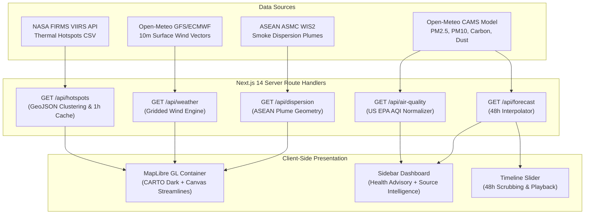

# 🌍 HazeWatch SEA — Live Southeast Asia Haze Intelligence Platform

[](https://nextjs.org/)
[](https://www.typescriptlang.org/)
[](https://tailwindcss.com/)
[](https://maplibre.org/)
[](https://vitest.dev/)

**HazeWatch SEA** is an environmental geospatial intelligence platform engineered to monitor, forecast, and analyze transboundary haze and ambient air quality across Southeast Asia (Malaysia, Singapore, Indonesia, Thailand, and Brunei).

Built with a map-first glassmorphic interface, HazeWatch SEA synthesizes real-time NASA FIRMS thermal satellite observations, numerical ECMWF atmospheric reanalysis, 48-hour forward trajectories, and localized meteorological wind vectors into actionable public health insights.

---

## 📸 Key Features

- **🗺️ Interactive Map-First Geospatial Workspace**:
  - High-performance MapLibre GL engine with CARTO dark matter basemaps.
  - Multi-layer toggles: NASA satellite fire hotspots, ECMWF PM2.5 haze intensity, surface wind streamlines, and ASMC smoke dispersion plumes.
  - Interactive clustering, custom thermal anomalies, and coordinates inspection.
- **🛰️ NASA FIRMS VIIRS Satellite Detection**:
  - Active fire anomaly detection (NOAA-20 / NOAA-21 NRT) with Fire Radiative Power (FRP in MW).
  - Server-side parsing and caching to maximize performance while minimizing API consumption.
- **💨 Physics-Driven Animated Wind Streamlines**:
  - HTML5 Canvas particle engine rendering meteorological wind vectors ($u$ and $v$ components) computed from Open-Meteo numerical weather forecasts.
- **⏳ 48-Hour Interactive Predictive Timeline**:
  - Scrub backward and forward in time across a 48-hour forecast horizon in local Malaysia Standard Time (UTC+8).
  - Dynamic timeline playback with automated step animation.
- **🏥 Segmented Public Health Advisories**:
  - Tailored guidance for the General Public, Sensitive Groups (asthma/respiratory/cardiac/elderly), Outdoor Workers, and Schools/Children.
  - Contextual N95 respirator recommendations and indoor filtration measures.
- **🧭 Quantitative Haze Source Intelligence**:
  - Algorithmic upwind thermal cluster analysis calculating spatial distance, FRP, and angular alignment with incoming surface wind vectors.
  - Transparent legal non-attribution notice and scientific uncertainty ratings.
- **📊 Standard Harmonization (US EPA AQI vs. Malaysia APIMS API/IPU)**:
  - Transparent distinction between the US EPA standard equation used for cross-border consistency and national DOE APIMS reporting standards.

---

## 🏛️ System Architecture



---

## 🚀 Getting Started

### 1. Prerequisites
- **Node.js**: v18.17.0 or higher
- **npm**: v9.0.0 or higher

### 2. Installation
```bash
git clone https://github.com/jjohntan/HazeWatch-SEA.git
cd HazeWatch-SEA
npm install
```

### 3. Environment Configuration
Copy `.env.example` to `.env`:
```bash
cp .env.example .env
```

Edit `.env` to configure your API keys:
```env
# NASA FIRMS (Fire Information for Resource Management System) Map Key
# Free registration at: https://firms.modaps.eosdis.nasa.gov/api/map_key/
NASA_FIRMS_MAP_KEY=your_nasa_firms_map_key_here

# Optional: Cache TTLs in seconds (defaults: AQI=1800, Hotspots=3600)
CACHE_TTL_AIR_QUALITY=1800
CACHE_TTL_HOTSPOTS=3600
```
> **Note**: If `NASA_FIRMS_MAP_KEY` is omitted, the application automatically falls back to an embedded regional satellite baseline for Southeast Asia, ensuring complete out-of-the-box functionality.

### 4. Run Development Server
```bash
npm run dev
```
Open **[http://localhost:3000](http://localhost:3000)** in your browser.

---

## 🧪 Testing & Quality Assurance

HazeWatch SEA features a comprehensive test suite powered by **Vitest**:

```bash
# Run all unit and integration tests
npm test

# Run tests in watch mode
npm run test:watch

# Run linter
npm run lint

# Production build verification
npm run build
```

### Test Coverage Highlights:
- **AQI Calculation & Breakpoints**: Validates US EPA breakpoints (0-50 Good, 51-100 Moderate, 101-150 USG, 151-200 Unhealthy, 201-300 Very Unhealthy, 301-500 Hazardous).
- **NASA FIRMS CSV to GeoJSON**: Parses satellite telemetry, validates bounding box boundaries, and formats coordinate points.
- **Wind Vector Dynamics**: Validates trigonometrical $u$ (eastward) and $v$ (northward) vector transformations and meteorological compass bearings.
- **Public Health Logic**: Validates persona-specific advisory generation and N95 recommendation thresholds.
- **End-to-End Workflow**: Validates full data pipeline integration from raw sensor readings to advisory outcomes.

---

## 🌐 Deployment to Vercel

The application is pre-configured for zero-configuration deployment on [Vercel](https://vercel.com/):

1. Push your repository to GitHub.
2. Import the project into your Vercel Dashboard.
3. Add the `NASA_FIRMS_MAP_KEY` environment variable under **Project Settings > Environment Variables**.
4. Deploy! Next.js 14 App Router and route caching will handle global edge distribution automatically.

---

## 📜 Scientific Methodology & Legal Disclaimers

1. **Standard Difference**: Air Quality Index (AQI) scores presented on this platform are computed in accordance with the United States Environmental Protection Agency (US EPA) standard formula to provide an unbroken baseline across all ASEAN territories. Malaysia's official Department of Environment (DOE) calculates the Air Pollutant Index (API/IPU) using distinct national breakpoint algorithms.
2. **Attribution Limitations**: Haze source risk indications are computed numerically via surface wind vector alignments and satellite thermal signatures. Thermal anomalies detected by satellites do not establish legal culpability or cross-border liability.
3. **Medical Disclaimer**: Guidance provided under the Public Health Advisory tab is intended solely for general environmental awareness and does not substitute professional medical diagnosis or personalized clinical advice.

---

## 📄 License
This project is licensed under the MIT License — see the [LICENSE](LICENSE) file for details.
